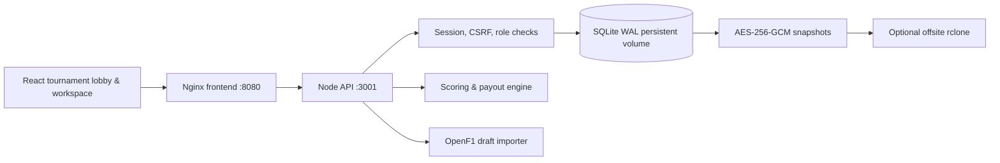

# Tournament-scoped system architecture



## Tenant boundaries

```text
user ──< tournament_members >── tournament
                                  │
                              seasons (year unique WITHIN tournament)
                                  │
                       ┌──────────┴─────────┐
                    weekends             championship picks
                       │
             ┌─────────┴─────────┐
        submissions           results & score snapshots

tournament season ───────── ledger (immutable cash entries)
```

All row queries using a season or weekend ID first verify tournament membership in the backend. Commissioner writes additionally require `tournament_members.role = 'commissioner'`. The shared standings and payout engines select only members of the relevant tournament. Data does not pass through a client-controlled `tournamentId` without server verification.

## Separate runtime ownership

The React app is an independently built and served static SPA with reusable page components. It never imports backend source. Node API owns its own scoring functions and durable database. For low-cost deployment, nginx and Node are independent processes/containers connected via internal network; the SQLite writer remains single-process.

A future managed PostgreSQL migration can preserve the API and frontend separation. A multi-instance backend would additionally require distributed OpenF1 rate limiting, coordinated backups and transaction retry handling.
