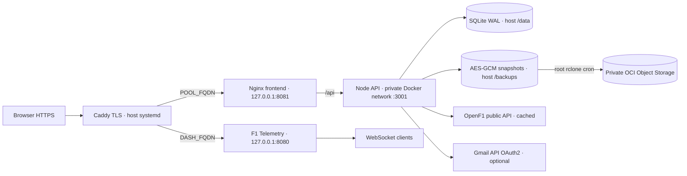

# Production Support Centre · v2.3

**GRIDLOCK / F1 Telemetry | Oracle Cloud · Docker · Caddy · SQLite · Gmail**

> **Safe to publish.** This repository deliberately does not include the unredacted production PDFs, public IPv4 address, SSH user/key paths, personal Gmail address, OCI tenant identifiers, customer access keys, refresh tokens, `.env` values, or real backup objects. Angle-bracket values are examples; resolve live values through your authorized password manager, OCI console, and host inventory.

| System | As-built deployment | Code branch | Responsibility |
| :-- | :-- | :-- | :-- |
| GRIDLOCK | Caddy → loopback :8081 → Nginx → backend :3001 → SQLite | `f1-prediction-pool/main` | Tournaments, scoring, financial ledger, encrypted email outbox |
| F1 Telemetry | Caddy → loopback :8080 → Express/WebSocket | `f1_telemetry/weekend-tyre-sets` | Live telemetry, broadcast synchronization, tyre calculations |

**Start here:** [Production Support Handbook](SUPPORT_HANDBOOK.md) · [Portable 25-page PDF](GRIDLOCK-Production-Support-Handbook-v2.3.pdf) · [Cloud & code map](CODE_AND_CLOUD_MAP.md) · [Deployment](DEPLOYMENT.md) · [Incident playbooks](INCIDENTS.md) · [Backup/restore](BACKUP_RECOVERY.md) · [Security](SECURITY_AND_SECRETS.md) · [v2.3 reconciliation](V23_RELEASE_NOTES.md)

## Operational posture

- **Source of truth:** repository code/config is verified at the linked branch; the 21 November 2026 v2.3 PDFs describe the deployment as built, **but this repository cannot verify the live VM's current settings**. Confirm before change.
- **Availability:** manual deployment is supported; [optional manual GitHub Actions deployment](../../.github/workflows/deploy-production.yml) requires SSH credentials and host verification configured by an authorized operator. No push-triggered production deployment is enabled by this change.
- **Persistence:** single SQLite writer using WAL; immutable financial ledger/history; encrypted local snapshots and *separately scheduled* offsite object-storage copies.
- **Secrets:** canonical production environment is stored outside Git under `/etc/f1-env/`; `.env` in the repository is a symlink. Actual credentials never belong in Git, support tickets, screenshots or CI logs.
- **Cost:** designed around Always Free resources; limits and billing terms may change. Check actual quotas and Budget alerts in OCI rather than assuming perpetual €0 charges.
- **Privacy:** documents use `POOL_FQDN`, `DASH_FQDN`, `<VM_HOST>`, `<OCI_BUCKET>`, `<OPERATOR_EMAIL>` and similar placeholders. The secure inventory, not these pages, holds actual values.

## Quick navigation

1. **Incident now?** Use the severity matrix and symptom routing in [Incident Playbooks](INCIDENTS.md).
2. **Looking for a function or data store?** Use [Code & Cloud Map](CODE_AND_CLOUD_MAP.md).
3. **Deploying or updating configuration?** Follow [Deployment](DEPLOYMENT.md) and [Release Checklist](RELEASE_CHECKLIST.md).
4. **Recovering data?** Review [Backup & Disaster Recovery](BACKUP_RECOVERY.md) *before* invoking restore.
5. **Touching keys, mail or administrative access?** Read [Security & Secrets](SECURITY_AND_SECRETS.md).

## Topology

*The public telemetry and pool domains are deliberately replaced with host aliases in this published diagram.*
