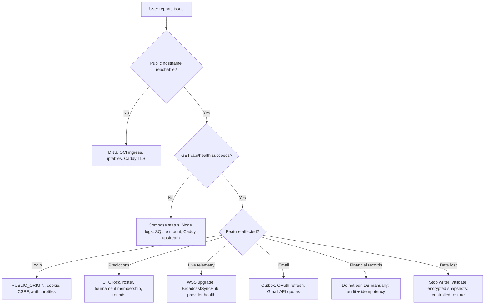

# GRIDLOCK · Production Support Handbook

**Runbook edition 2.3 | 21 November 2026 | Audience: developer, on-call operator, release manager**

| | |
| --- | --- |
| **Environment** | One Oracle Cloud Infrastructure Always Free ARM64 Ubuntu 24.04 VM, Caddy service, two isolated Docker Compose stacks |
| **App entry points** | `https://<POOL_FQDN>` (GRIDLOCK) and `https://<DASH_FQDN>` (telemetry) |
| **Git branches** | `f1-prediction-pool/main` and `f1_telemetry/weekend-tyre-sets` |
| **Host containers** | Pool frontend loopback `:8081`, telemetry loopback `:8080`; backend Docker-internal `:3001` |
| **State** | GRIDLOCK SQLite WAL + encrypted backup files on VM bind mounts; telemetry documented as stateless |
| **Source documents** | Sanitized synthesis of three operator-supplied v2.3 deployment documents; originals are **not committed** |
| **Authority** | Do not treat this public handbook as proof of currently running services or cloud permissions; verify the VM and cloud console |

## How to use this handbook

For urgent production faults, start at [Incident Response](INCIDENTS.md). For planned changes, use the [Release Checklist](RELEASE_CHECKLIST.md) before [Deployment](DEPLOYMENT.md). For troubleshooting a feature, follow [Code & Cloud Map](CODE_AND_CLOUD_MAP.md), then check [Security](SECURITY_AND_SECRETS.md) before capturing logs. For data recovery, follow [Backup & Disaster Recovery](BACKUP_RECOVERY.md) and do not improvise with live SQLite file copies.

### The first five commands on the VM

```bash
cd /opt/f1/f1-prediction-pool
./scripts/production/doctor.sh           # Read-only local preflight, no secrets printed
docker compose ps
docker compose logs --tail 80 backend   # Local-only; redact before sharing
curl --fail --silent --show-error http://127.0.0.1:8081/api/health
sudo systemctl status caddy --no-pager
```

Avoid `curl -I` for `/api/health`: it issues **HEAD**, while the app exposes **GET**, which can return an unrelated authorization error. Use `curl -i` or `curl --fail` instead.

## Request and dependency flow

1. Public HTTPS reaches Caddy on 443 after DuckDNS A-record resolution, OCI security-list and host firewall admission. Caddy issues/renews TLS certificates and forwards to distinct loopback-bound app ports.
2. GRIDLOCK's unprivileged Nginx serves the React SPA and forwards `/api/` to the isolated Node backend on Docker's internal network. Cookies remain HTTP-only; backend CSRF protection validates the public `Origin` against `PUBLIC_ORIGIN`.
3. The Node API enforces tournament membership and commissioner/operator permissions. It writes session state, drafts, classification snapshots and the ledger transactionally to SQLite on a host volume. Qualifying locks are UTC timestamp-based; they are not cron-dependent.
4. OpenF1 feeds provisional calendar/roster/classification data through a shared cache. Classification publication requires operator/commissioner review and scoring preview; external data is not automatically official.
5. Notifications are encrypted in SQLite and delivered using Gmail OAuth2 when configured. User verification, preferences and quotas apply. Delivery is independent of prediction-lock correctness.
6. The backend produces AES-256-GCM snapshots on graceful termination and after publication. A host-level root cron/rclone job copies snapshots to private OCI Object Storage. A successful local snapshot does **not** prove offsite replication.

## Key reliability invariants

| Invariant | Why it matters | Verify |
| --- | --- | --- |
| Only the frontend is bound to `127.0.0.1:8081` | Caddy is sole public TLS ingress | `docker compose ps` / `ss -ltn` |
| Telemetry uses a distinct `127.0.0.1:8080` host port | Prevents collision with GRIDLOCK | `docker ps`, `ss -ltn` |
| Backend API has **no host `ports:` mapping** | Prevent direct API exposure | `docker compose config` |
| `./data` and `./backups` are bind mounts | Safe container rebuild/restart | `docker inspect`, host `stat` |
| Production `.env` resolves outside Git | Re-clones do not erase credentials | `readlink -f .env` (path only, never contents) |
| Caddy certificate renewals work | Public TLS availability | `systemctl status caddy`, `journalctl` |
| Root rclone job can read mode-0600 snapshots | Offsite recovery point | `sudo crontab -l`, `rclone ls` (metadata only) |
| `MAIL_PROVIDER=gmail` has OAuth2 send scope | Official email delivery | Operator mail panel, safe aggregate status |
| SQLite has one active backend writer | Avoid multi-writer contention | Compose replica count = 1 |
| Financial operations remain auditable | No implicit cash movement | Tournament ledger/audit logs |

## Operator consoles

**OCI:** sign in to the *authorized tenant* and select the designated region, then use Compute → Instances (VM), Networking → Virtual Cloud Networks (security list), Networking → Reserved public IPs, Storage → Buckets (private encrypted snapshot copies), and Billing → Budgets (alerts). Never reproduce tenant, instance OCIDs or public IPv4 in GitHub issues.

**Google Cloud:** choose the mail project, then APIs & Services → Enabled APIs (Gmail API), Google Auth Platform → Audience (In production), Clients (OAuth), and the GRIDLOCK operator UI (mail queue/delivery). Do not print, screen-share or log the refresh token.

**DuckDNS:** check the authorized DNS A-records; do not change the external address without first validating OCI networking and Caddy routing.

**GitHub:** review the matching branch and Actions CI; the production deployment workflow is opt-in and manual. Configure environment protection and SSH secrets only through repository settings—never commit `.env` or a private key.

## Common debugging sequence



## Routine schedule (suggested, not evidence of configured automation)

| Cadence | Operator action |
| --- | --- |
| Every deploy | CI green, correct Git ref, VM preflight, smoke check, audit logs, verify no ports exposed |
| Before an F1 event | Roster/schedule accurate, lock UTC correct, OpenF1 capacity, email queue status, recent backup |
| After publication | Published score digest stable; encrypted backup created; offsite copy verified |
| Daily | Check VM filesystem capacity, container health, Caddy errors and remote backup metadata |
| Weekly | Review OCI billing/budget alert and security patches, inspect failed email jobs, backup freshness |
| Monthly / recovery exercise | Restore a backup to an **isolated** environment and verify SQLite foreign keys, standings and ledger |

## Operations boundaries

- **Never** expose production `.env`, OAuth/OCI credentials, SSH key, actual user emails, password hashes, tokens or raw database in a public issue.
- **Never** run `git clean -fdx` or prune bind-mounted volumes as part of deployment.
- **Never** run `docker compose down -v` on the production pool (volume deletion risk); prefer `docker compose up -d --build`.
- **Never** assume the Cloud VM is an exact copy of the PDFs: reconcile live `docker compose config`, systemd, firewall, rclone cron and OCI console before making a change.
- This system **records** prize entitlements; it does not transfer or custody money. Real payouts require separate manual reconciliation and legal review.

## Full chapters

[1 · Code & Cloud Map](CODE_AND_CLOUD_MAP.md) · [2 · Deployment & Secrets Migration](DEPLOYMENT.md) · [3 · Incident Playbooks](INCIDENTS.md) · [4 · Backups & Recovery](BACKUP_RECOVERY.md) · [5 · Security Controls](SECURITY_AND_SECRETS.md) · [6 · Release Checklist](RELEASE_CHECKLIST.md) · [7 · v2.3 Decisions & Source Reconciliation](V23_RELEASE_NOTES.md)
